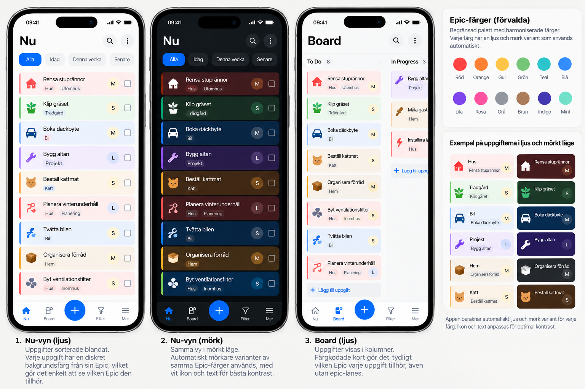

# Tendly — UX/UI Specification

**Version:** 1.0  
**Status:** Approved visual direction; normative interaction guidelines  
**Reference:** [approved-visual-direction.png](references/approved-visual-direction.png)

> This document specifies **how** the product should look and behave in use. The [Product Specification](../product/product-specification.md) defines **what** it must do. Concept art shows the desired visual mood but contains potentially incorrect generated text/controls; written specs always win.

## 1. Design intent

**Things 3 simplicity × Linear precision**, without the visual or operational complexity of ClickUp. Feel calm, deliberate, polished and fast. Every frequent action should be easy to discover; sophisticated planning controls should appear only when opened. Do not add dashboard counters, decorative charts or enterprise navigation by default.

Design for a household member opening a phone to see **what can I do now**, check something off, add a comment/photo or quickly capture a task. Desktop should excel at longer writing, large boards, filter construction and settings. **No important feature is desktop-only.**

### Interaction principles

- **Progressive disclosure:** Title-first capture; secondary metadata tucked into details; advanced configuration behind predictable controls.
- **Recognizable context:** Epic color/icon remains visible on mixed, ungrouped cards.
- **Density hierarchy:** Prominent titles; effort **XS–XL** next; date/assignee/progress as unobtrusive metadata; exact duration secondary.
- **Direct manipulation:** Tap to open, tap/keyboard to complete, drag where helpful, always offer an accessible equivalent.
- **Immediate feedback:** Optimistic response, subtle save/conflict/error feedback, Undo where applicable.
- **Consistent semantics:** Never add extra workflow states like `Waiting`, `Urgent`, `Normal` or `Blocked` as columns/priority levels. Blocking is an availability indicator, not a workflow column.

## 2. Colors, identity, typography and icons

### 2.1 Epic palette (normative)

- Each epic chooses **one hue** from a **curated 12–16-hue palette** with consistent perceived lightness/saturation. Users do **not** choose arbitrary epic background hex values independently for each theme.
- Generate theme variants using **OKLCH** or equivalent perceptually uniform color transforms. Preview each option in both themes.
- **Light:** very light, softly tinted card fill; dark/near-black title and monochrome icon. **Dark:** deliberately darker tinted card fill; white/near-white foreground and icon. Preserve readable WCAG contrast in both.
- A card without an epic has a neutral surface. Card color is determined by effective epic, even when epic lanes are disabled or cards are sorted across epics.
- A restrained left edge/accent may reinforce epic identity but must not add visual clutter. Epic background is the primary color carrier.
- Semantic colors for errors, deadline warnings and focus must remain distinguishable from epic identity; include an icon/text indicator rather than color alone.

### 2.2 Icon language

Use **Lucide or a comparably coherent monochrome outline set** for UI actions and selectable entity icons. No colorful emoji-style icon collage. The effective epic icon is the primary icon on a task card; **a separate custom task-icon property is not required in v1.0**.

Provide one searchable icon picker for epics, places, tags, resources, filters and views. Non-epic entities can select predefined color swatches and (where appropriate) custom color via picker; the **epic palette restriction takes precedence** for epics. Keep stroke, sizing and spacing consistent. Icon foreground on colored epic cards is dark in Light and light in Dark.

### 2.3 Layout system

- Neutral app chrome, consistent spacing scale, modest rounded corners, subtle borders and very limited shadow use. Rounded cards with enough whitespace to tap confidently on a phone.
- Use a readable contemporary sans (e.g. **Inter**), responsive type scale and clear focus states. Avoid large empty headline regions or dense metadata matrices.
- Support **System** (default), **Light**, **Dark** themes per user. Support English and Swedish UI with appropriate locale formats and account-level language override.
- Touch targets should be comfortable; do not rely on hover, color alone or drag alone.

## 3. Shared navigation and page shell

### Mobile

Fixed bottom navigation: **Now | Board | More** (localized); one prominent global **+** quick-capture action. Search and saved views are reachable through More; user favorites should not force extra permanent tabs. Keep the main task list and filter bar visible without a large dashboard header.

### Desktop

Collapsible left navigation with Now, Board, favorite shared views, search and settings. Compact icon-only mode when collapsed. Keyboard shortcuts: `N` for quick task, `Cmd/Ctrl+K` for global search, normal platform Undo/Redo shortcuts. Hide the household switcher if there is only one membership.

Both form factors share the same underlying view/filter/task behavior; switching devices must not change the underlying data. Navigation favorites and active filter toggles are personal, while view/filter definitions are shared.

## 4. Task cards

A default compact card should expose only the fields that help someone decide/act:

1. **Title** — visually primary, legible at a glance.
2. **Effective epic** — tinted background + monochrome epic icon; no requirement to spell out the epic on every card.
3. **Effort size** — XS/S/M/L/XL chip if set. Do not display exact minutes prominently.
4. **High priority** — a discrete single badge/icon **only when checked**; no priority lanes or extra levels.
5. **Deadline** — only if present, with clear overdue/near-due treatment; not a separate status.
6. **Subtask progress** — e.g. `2/5`, only if relevant.
7. **Assignees** — small avatars/initials where helpful.

Each saved view can control which metadata is visible on cards and whether subtasks are separate cards. Blocked/unavailable cards, when intentionally shown on planning boards, can have a subtle indicator and an explanation in details. Do not clutter default Now cards with unavailable/blocked work.

Tap/click card opens details. Provide a fast completion affordance. DnD actions show previews and drop-zone differences (reorder, move column, epic transfer, convert to child); accidental reparenting must be difficult. Mobile provides menu-driven equivalents.

## 5. Now view

The home screen is a **vertical task list**, not a board, KPI panel or agenda calendar. The purpose is actionable tasks with minimum distractions.

- Apply the Product Specification's default base filter: **Within a Month, To Do, In Progress**, with satisfied dependencies and effective earliest-start date reached.
- Render a horizontal **view-specific quick-filter chip bar** above tasks. Chips are saved filters, not hardcoded property dropdowns. Multiple active chips narrow via AND.
- Show a compact location selector when the user wants to set their current place (manual in v1.0); location does not filter tasks unless an explicit base/quick filter uses it.
- Support simple sensible empty states: *no actionable tasks* versus *filters have zero matches*; show active chips and a clear reset action.
- Keep create-task easy to reach regardless of scroll position.

## 6. Board and saved views

### Workflow display

The board has **exactly six** visible column choices, translated by locale: Someday, Within a Year, Within a Month, To Do, In Progress and Done. They map to the **single `Column` property**. Do not show an additional editable “Planning horizon” or “Work status” field; these are implementation concepts.

**Desktop:** multiple columns side by side, horizontal overflow on smaller desktops, drag between columns and optional epic swimlanes. **Mobile:** exactly one active column shown at once, with swipe between columns **and** a direct column selector. With epic grouping, use collapsible sections within the active mobile column; desktop lanes are collapsible horizontal swimlanes. Global epic ordering applies everywhere. The Unassigned epic lane is last, empty lanes hidden unless that view requests them.

A view can be **Board** or **List** and records base filter, selected quick-filter chips, sorting (manual/default, deadline, High, effort, created date), epic lanes on/off, empty-lane visibility, visible card properties and subtask-as-card mode. Only group by epic; assignee/place are filter predicates, not lanes. All views are shared; users personally favorite views for their navigation.

Built-in Now/Board views are editable and resettable but not deletable. View editing should show shared impact and support a restore-default command for built-ins.

## 7. Filter experience (core differentiator)

### Quick-filter bar

A horizontal, scrollable set of **saved filter chips**, specific to the active view. A tap/click toggles. Selected chips remain active across sessions for **that user and that view**. A `+` opens the shared filter library / create flow. Right-click or long-press opens Edit, Duplicate and Delete. Ensure buttons work equally well on touch and keyboard. Do not invent permanent `All / Now` segmented controls inconsistent with the underlying saved filter model.

### Visual filter builder

Use nested groups and typed controls for AND/OR/NOT, field choice, operator and values. Fields are expressed in domain/user terms (`Column`, `Size`, `Place`, `Available`, `Requires resource`, etc.); never expose `planningBucket` as a second task selection. Dynamic operands include Today, Current User and manually selected Current Place, with GPS becoming available later.

- **Live matching count and results** as edits are made, without committing changes to a saved definition.
- **Desktop:** a side panel/adjacent editor leaves results visible; **mobile:** full-screen editor with a preview switch/area.
- Filter creation/editing needs **explicit Save or Cancel**, unlike normal task field autosave. Shared-filter edits clearly warn they update all views that reference the definition; filter version history supports restoring an older definition.
- The view's base predicate always applies, and active chips combine by AND. If zero results, show an intelligible empty state, never silently remove selected filters.

## 8. Task details, creation and editing

### Details layout

**Desktop:** right-side panel, board/list remains in context. **Mobile:** full-screen task details with an obvious Back action. Edit values in place; keep advanced values collapsed or categorized without hiding essential state.

Suggested information flow: **title and completion / column / epic / priority checkbox / effort size**, then assignees, optional dates, place/resource/tag chips and dependencies, then rich description, nested subtasks, attachments and a bottom area with **Comments** and **Activity** as separate tabs. Present inherited values as inherited, offer per-property override controls, and distinguish intentionally excluded inherited multi-values. Users should be able to return to inheriting.

A task's **High** input is a single checkbox/toggle, not a three-level picker. Place names are physical locations such as Grankottevägen 30 and Sandvreten; generic Outdoors should be a tag. Size (XS–XL) remains the primary estimate signal; exact hours/minutes live deeper in details.

### Quick capture

Global `+` or desktop `N`, immediate title-entry, Enter to create. Without context use Someday; in a known column/epic lane adopt that column/epic. Optional expansion permits description and all properties. Avoid a modal demanding fields for an ordinary household task.

### Editing behavior

Normal fields use autosave. Indicate pending/saved/failed subtly; allow retry and avoid losing text. Provide Undo/Redo for meaningful recent changes, mobile Undo toast after completion/move/delete, and a conflict dialog only for actual conflicting concurrent field edits. Ordinary drag and drop is undoable; do not force confirmation unless the action is consequential (blocked start, later child deadline warning, finishing parent with incomplete descendants, dependency-affecting deletion, etc.).

### Subtasks

Initially display as simple checklists with nested reveal on demand, but each item opens full-featured task details. Show `n/N` completion on parent card; finishing a subtask does not auto-complete the parent. Where subtasks appear independently, provide a compact visible parent breadcrumb/context.

## 9. Rich content, search and notifications

Use a consistent rich-text control for descriptions and comments: headlines, formatting, list, checklist, links, images, quote, code, Markdown shortcuts and user mentions. Support paste from clipboard and camera/photo attachments in task/comments. Use thumbnail browsing and full-size viewing. Comments remain a **flat chronological list**; Activity is a separate history tab. Mention notification delivery arrives in v1.1, though mention editing is in v1.0.

Global search is incremental, includes archived results and supports the same filters. Mobile and desktop search affordances must be equally discoverable; desktop `Cmd/Ctrl+K`.

**v1.1 only:** in-app notification center and device Web Push settings, quiet hours and notification category preferences. Do not put dead notification controls into the v1.0 user interface as if they were active.

## 10. Administration and settings

Settings include household, members, account/passkeys, locale/theme, epics, places, resources, tags, size thresholds, saved views/filters, house defaults, SMTP and About/version. Installation-wide settings such as SMTP require separate deployment-administrator privileges. Household Admin membership does not grant them. Admin-only operations are identified without crowding Member UI. Epic management offers manual reorder and preview of light/dark swatches.

Backup UI is **not** part of v1.0; CLI manual backup/restore documentation is. Cloud provider connection/backup scheduling/restoration UI appears in **v1.3**.

## 11. Accessibility, resilience and motion

Aim for WCAG 2.2 AA with effective contrast checked against every palette card surface; screen-reader labels and semantics, visible keyboard focus, responsive touch targets and alternatives to gestures/drag. Respect reduced-motion preferences. Focus behavior should remain predictable when details open/close. API errors and lack of connectivity should show actionable text; no fake offline write support in v1.0.

## 12. UX acceptance checkpoints

- An epic-colored card has its **light** background with dark icon/text and **dark** background with light icon/text, remaining recognizable with lanes off.
- A user can create and finish a task from mobile without visiting Settings or opening a complex multi-step form.
- Selecting two saved quick filters narrows results via AND; switching views preserves that view's distinct filter bar and personal toggle state.
- A task detail shows a single `Column` control with six valid options, boolean High, prominently displayed size, and actual named place(s).
- On mobile Board, the user sees one column at a time and can swipe or jump directly to another.
- Filter Builder previews live results but does not modify a shared definition until Save.
- Completing, moving or deleting a task provides appropriate feedback and near-term Undo without wiping other users' changes.

## 13. Design reference limitations

The image illustrates visual rhythm, tinted epic cards, light/dark surfaces and density, **not** literal labels, states or features. An implementation that copies a hallucinated status/priority from an image violates the Product Specification. Implementers should create **real interactive UI** to fine-tune spacings/contrast instead of using generated mockups as pixel-perfect assets.
